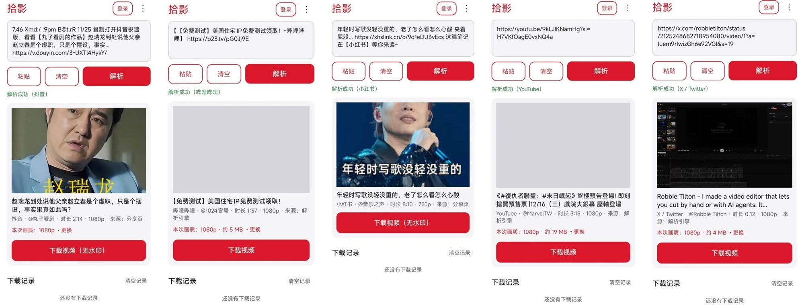
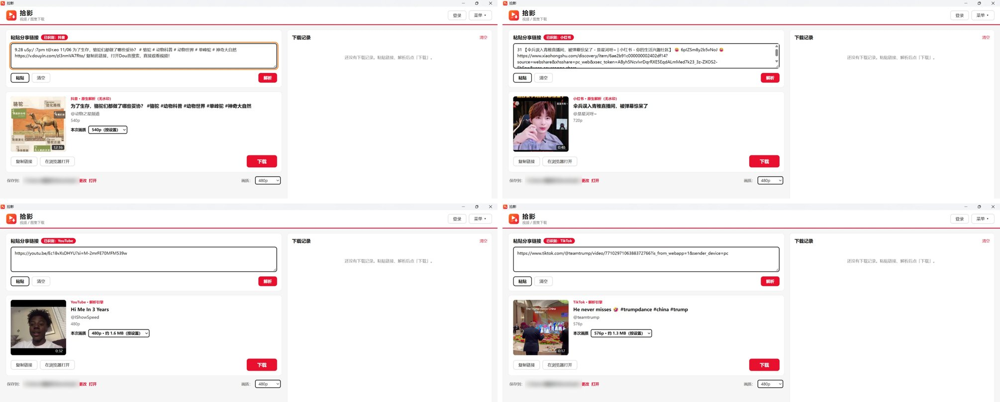
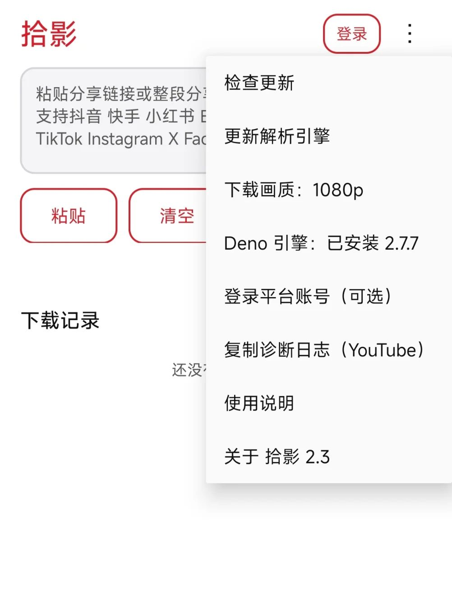

<div align="center">


# 拾影

**粘贴链接就能下载视频 · Android + Windows + macOS**

抖音、快手、小红书、TikTok、X、B 站、YouTube、微博、Instagram……把分享链接贴进来，自动识别平台，一键保存。<br>
免费 · 开源 · 无广告 · 不用注册

[](https://github.com/CNYYNB/shiying/releases/latest)
[](LICENSE)
[](https://github.com/CNYYNB/shiying/stargazers)

**手机版**



**电脑版**



</div>

## 下载

到右边的 **Releases** 下载最新版：

- 手机：`Shiying-Android-2.4-arm64-v8a.apk`（绝大多数手机装这个，Android 7 及以上）
- 老的 32 位手机：`Shiying-Android-2.4-armeabi-v7a.apk`
- Windows：`Shiying-Windows-Setup-1.2.0.exe`（Windows 10/11 64 位）
- Mac（M 芯片）：`Shiying-macOS-1.2.0-arm64.zip`；Mac（Intel）：`Shiying-macOS-1.2.0-x64.zip`（macOS 12 及以上，安装步骤见 [电脑版/README.md](电脑版/README.md)）

## 支持哪些平台

| 平台 | 解析方式 | 实测 | 备注 |
|---|---|---|---|
| 抖音 | 原生 | ✅ 能下 | 无水印 |
| 快手 | 原生 | ✅ 能下 | 视频 + 图集 |
| 小红书 | 原生 | ✅ 能下 | |
| TikTok | yt-dlp | ✅ 能下 | |
| X / Twitter | yt-dlp | ✅ 能下 | 纯图帖不下 |
| 哔哩哔哩 | yt-dlp | ✅ 能下 | |
| YouTube | yt-dlp + Deno | ✅ 能下 | 含 Shorts；对 IP 要求较高，见下方说明 |
| 微博 | yt-dlp | ✅ 能下 | |
| 西瓜 / 头条 | yt-dlp | 未测 | |
| Instagram | yt-dlp | ✅ 能下 | 易限流 |
| Facebook | yt-dlp | 未测 | |
| Vimeo | yt-dlp | 未测 | 常需登录 |
| Telegram | 账号登录 / yt-dlp | 未测登录 | 不登录只能下公开频道；登录后可下私密频道、超级群、评论、相册；禁止保存内容的不下 |
| 其他网站 | yt-dlp | — | yt-dlp 支持的都行 |

「未测」是作者的测试环境（海外 IP）被平台拦截、没能实测，不代表不能用。欢迎在 Issues 里反馈你的结果。

**不支持**：视频号、直播、私密 / 仅好友 / 已删除内容、会员专享内容。

## 能做什么

- 复制链接后打开就自动识别，手机上也可以从 App 里直接「分享 → 拾影」
- 画质可选（最高 / 1080p / 720p / 480p / 360p / 省流量）
- 下载记录、取消下载、进度显示；手机版直接存进相册
- 需要登录的平台可以在 App 内网页登录（cookie 只保存在本机，交给 yt-dlp 使用）
- 手机版和电脑版都可登录 Telegram（用你自己的 api_id / api_hash，登录状态加密保存在本机），步骤见 [电脑版/README.md](电脑版/README.md)
- 解析引擎 yt-dlp 可在应用内更新
- 电脑版 / Mac 1.2.0 起内置更新：菜单「检查更新」，也会启动时自动检查，一键下载安装（1.1.1 需手动装一次 1.2.0）
- 诊断日志一键复制（会去掉 cookie 和 token）

## 怎么用

1. 在抖音 / 快手 / B 站等 App 里点「分享 → 复制链接」。
2. 打开拾影，链接会自动填进去（也可以手动粘贴）。
3. 看一眼预览，选画质，点下载。

电脑版第一次运行会自动下载 yt-dlp、FFmpeg（以及 YouTube 需要的 Deno），国内会自动走镜像。

手机版下 YouTube 也需要 Deno 组件，App 内置了下载功能：点右上角菜单 →「Deno 引擎」，在 App 里直接下载安装即可，装好后会显示「已安装」和版本号。

更新 yt-dlp 和下载 YouTube 在国内一般需要开 VPN。

> **YouTube 对网络 IP 要求较高**：节点要干净（没被大量共享或滥用），否则容易报「Sign in to confirm you’re not a bot」或下载失败。遇到这种情况先换一个节点再试。

## Telegram 使用说明（手机版 2.4 / 电脑版 1.1.1 起）

**不登录**：只能下公开频道里的单条帖子（如 `t.me/频道名/123`）。判断方法：用浏览器打开链接，能直接看到并播放视频的就能下。

**登录后**：你账号能看到的私密频道、超级群、频道评论、话题、相册都能下。

1. 申请 api_id / api_hash（只做一次）：浏览器打开 [my.telegram.org](https://my.telegram.org)（国内需开代理）→ 输入带区号的手机号 → 验证码在 Telegram App 里（不是短信）→ 点 **API development tools** → App title 填 `shiying`、Short name 填 `shiyingpc`、Platform 选 Desktop → **Create application** → 复制 **api_id** 和 **api_hash**。
2. 在拾影「登录」→「Telegram 账号登录」，填 api_id、api_hash、手机号。
3. 代理：开了 Clash / v2rayN 系统代理一般可留空；连不上就填 `socks5://127.0.0.1:7890`（v2rayN 常见 `socks5://127.0.0.1:10808`）或 MTProxy 链接，可先点「测试连接」。
4. 发送验证码 → 在 Telegram App 里查看 → 填入登录；开了两步验证的再输密码。
5. 在 Telegram 里长按（电脑上右键）消息 →「复制消息链接」→ 粘贴到拾影 → 下载。

**注意**
- api_id / api_hash 和登录状态只加密保存在你自己的手机或电脑上，不要发给别人。退出：「登录 → Telegram 设置 → 退出 Telegram 登录」。
- 私聊和普通小群没有消息链接：先把消息转发到你自己建的私密频道，再复制那条的链接。
- 开了「禁止保存内容」的频道 / 聊天，拾影不下载。
- 不下载贴纸、语音、普通文件和付费内容；不支持 HTTP 代理和 `ee` 开头的 MTProxy。
- 请求太频繁 Telegram 会让你等待（会显示秒数），等一会儿再试。

## 使用须知

仅供个人学习，以及备份你自己有权保存的内容。请遵守各平台的服务条款和当地法律，**不要用于搬运、二次发布、商用或侵犯他人版权**。下载内容的版权归原作者所有。

## 目录

```
手机版/   Android（Kotlin，youtubedl-android = yt-dlp + Python + FFmpeg）
电脑版/   Windows + macOS（Electron + Node.js，调用 yt-dlp / FFmpeg / Deno；Telegram 用 GramJS）
```

### 编译手机版
需要 JDK 17+、Android SDK 34、Gradle 8.9：

```
cd 手机版
gradle :app:assembleRelease
```

正式签名：在 `手机版/` 放 `keystore.properties`（storeFile / storePassword / keyAlias / keyPassword），没有就用 debug 签名。技术细节见 `手机版/DEV-NOTES.md`。

### 编译电脑版
需要 Node.js 20+：

```
cd 电脑版
npm install
npm start        # 运行
npm run dist     # 打包 Windows 安装程序
npm run dist:mac # 打包 macOS（arm64 + x64）
npm test         # 运行测试
```

## 许可证

GPL-3.0。手机版打包了 youtubedl-android（GPL-3.0）及其 FFmpeg；第三方组件见 `手机版/NOTICE.md` 和 `电脑版/NOTICE.md`。
